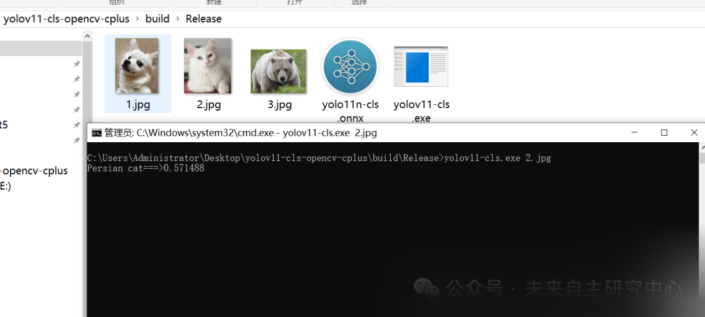

# [C++] deploy the Yolov11-cls image classification ONNX model using pure OpenCV

[Algorithm Introduction]

Deploying the YOLOv11-cls image classification ONNX model in C++ using pure OpenCV is a challenging task, as YOLOv11 is typically implemented with deep learning frameworks such as PyTorch, and OpenCV does not directly support loading and running PyTorch models. However, this can be achieved through some indirect methods, which involve converting the PyTorch model into ONNX format and then loading the ONNX model using OpenCV's DNN module.

The deployment process includes the following key steps:

1.

Ensure that the development environment has installed OpenCV 4.x (with DNN module) and the necessary C++ compiler.

1.

Convert the YOLOv11-cls model from PyTorch to ONNX format, which typically involves using the `torch.onnx.export` function from PyTorch.

1.

Load ONNX model using OpenCV's DNN module and ensure there is a configuration file (which describes the model architecture) and a category name file.

1.

Preprocess the input image (such as resizing, normalization, etc.), to meet the model's input requirements.

1.

Input the preprocessed image into the model and obtain the classification results.

1.

Post-processing of classification results, including parsing outputs.

It is important to note that as YOLOv11 is a complex model, its output may contain information from multiple layers, thus it requires careful parsing of the model output and post-processing based on the specific implementation of YOLOv11. Additionally, OpenCV's DNN module may have limited support for ONNX, and some features of YOLOv11 may not be directly implementable in OpenCV. In such cases, alternative solutions may be necessary.

In summary, deploying the YOLOv11-cls image classification model in C++ using pure OpenCV requires a deep understanding of the YOLOv11 model architecture, OpenCV's DNN module, and ONNX format.

[Effect Display]



[Implementation of Partial Code]

-
-
-
-
-
-
-
-
-
-
-
-
-
-
-
-
-
-
-
-
-
-
-
-
-
-
-
-
-
-

```
#include <iostream>#include<opencv2/opencv.hpp>#include<math.h>#include<time.h>#include "yolov11_cls.h"using namespace std;using namespace cv;using namespace dnn; int main(int argc,char* argv[]) {        if(argc==1)  {    cout<<"please input the image path"<<endl;    return 0;  }    string img_path = argv[1];  string cls_model_path = "yolo11n-cls.onnx";  Mat img = imread(img_path);  Yolov11ClsOnnx cls_net;  cls_net.LoadWeights(cls_model_path);  auto result = cls_net.Inference(img);  cout << result.class_name<<"===>"<<std::to_string(result.confidence) << endl;  getchar();  return 0;}
```

[Test Environment]

vs2019

cmake==3.24.3

opencv==4.8.0

[Operating Steps]

After compiling the exe with cmake, execute it.

yolov11-cls.exe [Image Path]

[Complete Source Code Download]


## Payment

Here is a pay link on Stripe ( https://buy.stripe.com/3cs8yP7sY87d0vu9AB ). Please contact me lonlonago@foxmail.com after funding $89, and I will send you a complete data files , thank you!


